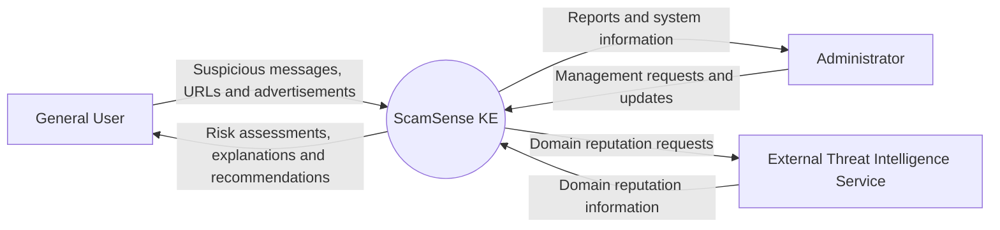
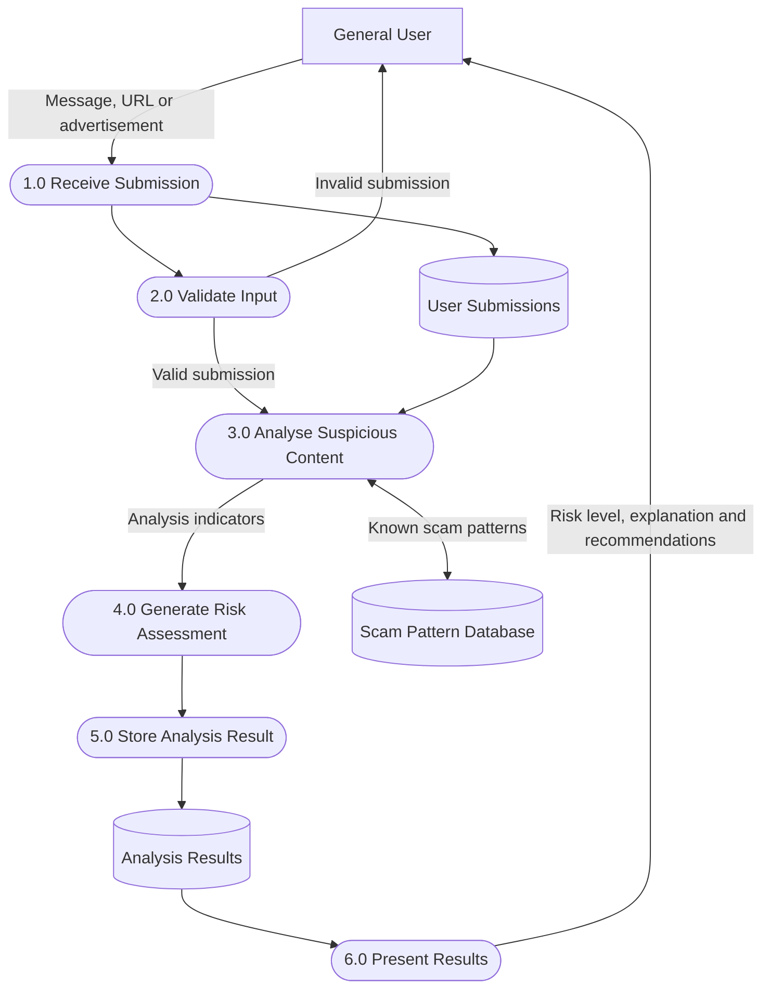

# Data Flow Diagram (DFD)

## 1. Introduction

A Data Flow Diagram illustrates how data enters, moves through and leaves the ScamSense KE system. It identifies the processes involved, external entities interacting with the system and data stores used to maintain information.

## 2. Level 0 DFD (Context Diagram)

The context diagram represents ScamSense KE as a single process and shows its interaction with external entities.

## 3. Level 1 DFD

The Level 1 diagram breaks down the main system process into smaller processes.

## 4. Description of Data Flow Processes

### 4.1 Receive Submission

The system receives suspicious messages, URLs or advertisements submitted by users through the web interface.

### 4.2 Validate Input

The system checks the submitted information to ensure it meets the required format and security rules. Invalid or incomplete submissions are rejected with appropriate feedback.

### 4.3 Analyse Suspicious Content

The analysis engine examines the submitted content using scam detection rules, text pattern analysis, URL analysis and other supported techniques.

### 4.4 Generate Risk Assessment

The system evaluates the indicators identified during analysis and generates an appropriate risk classification, accompanied by an explanation.

### 4.5 Store Analysis Result

The system stores relevant submission details and analysis results in the database, subject to data protection and retention requirements.

### 4.6 Present Results

The system displays the risk assessment, identified indicators and safety recommendations to the user.

## 5. Data Stores

- **User Submissions:** Stores relevant information submitted for analysis.
- **Scam Pattern Database:** Contains known scam indicators and detection patterns.
- **Analysis Results:** Stores generated assessments and explanations.

## 6. Summary

The DFD demonstrates how ScamSense KE receives, validates, processes, stores and presents information. It provides a clearer understanding of the movement of data within the proposed system.