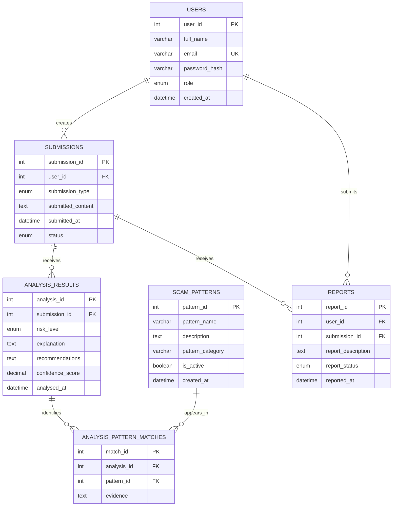

# Entity Relationship Diagram (ERD)

## 1. Introduction

The Entity Relationship Diagram illustrates the proposed structure of the ScamSense KE database. It identifies the main entities, their attributes and the relationships between them.

The database will initially be implemented using MySQL.

## 2. Database Entities and Relationships

## 3. Description of Database Entities

### 3.1 Users

The Users table stores information about individuals registered on the platform.

Its attributes include:

- user_id: Unique identifier for each user.
- full_name: Name of the registered user.
- email: User's email address, which must be unique.
- password_hash: Securely hashed password.
- role: Determines whether the account belongs to a general user or administrator.
- created_at: Date and time the account was created.

### 3.2 Submissions

The Submissions table stores suspicious content submitted for analysis.

Its attributes include:

- submission_id: Unique identifier for each submission.
- user_id: Identifies the user who submitted the content.
- submission_type: Specifies whether the submission is a message, URL or advertisement.
- submitted_content: Contains the submitted information.
- submitted_at: Records when the submission was made.
- status: Indicates the processing status of the submission.

### 3.3 Analysis Results

This table stores the results generated by the scam analysis engine.

Its attributes include:

- analysis_id: Unique identifier for each analysis.
- submission_id: Identifies the submission being analysed.
- risk_level: Stores the assessed risk classification.
- explanation: Explains the indicators identified by the system.
- recommendations: Provides appropriate safety recommendations.
- confidence_score: Stores an optional model confidence score where applicable.
- analysed_at: Records when the analysis was performed.

### 3.4 Scam Patterns

This table maintains recognised scam indicators and patterns used by the detection engine.

Its attributes include:

- pattern_id: Unique identifier for each scam pattern.
- pattern_name: Name of the identified pattern.
- description: Explanation of the pattern.
- pattern_category: Classification of the pattern.
- is_active: Indicates whether the pattern is currently being used.
- created_at: Records when the pattern was added.

### 3.5 Analysis Pattern Matches

This table connects analysis results with the scam patterns identified during analysis.

Its attributes include:

- match_id: Unique identifier for each match.
- analysis_id: Identifies the analysis in which the pattern was detected.
- pattern_id: Identifies the matching scam pattern.
- evidence: Describes the evidence supporting the match.

This table supports a many-to-many relationship between analysis results and scam patterns.

### 3.6 Reports

The Reports table stores reports submitted by users concerning suspicious content.

Its attributes include:

- report_id: Unique identifier for each report.
- user_id: Identifies the user submitting the report.
- submission_id: Identifies the related submission.
- report_description: Explains the reason for the report.
- report_status: Indicates whether the report is pending, under review or resolved.
- reported_at: Records when the report was submitted.

## 4. Explanation of Relationships

### Users and Submissions

One user can create many submissions, but each submission belongs to one user.

This represents a one-to-many relationship.

### Submissions and Analysis Results

One submission can have multiple analysis records, allowing the system to retain analysis history. Each analysis record belongs to one submission.

### Analysis Results and Scam Patterns

One analysis can identify multiple scam patterns, and one scam pattern can be identified in multiple analyses.

This is a many-to-many relationship implemented through the Analysis Pattern Matches table.

### Users and Reports

One user can submit multiple reports, but each report is submitted by one user.

### Submissions and Reports

One submission can receive multiple reports, while each report refers to one submission.

## 5. Database Design Considerations

The database will use primary keys to uniquely identify records and foreign keys to establish relationships between tables.

Additional considerations include:

- Unique email addresses to prevent duplicate accounts.
- Password hashing rather than storing plain-text passwords.
- Appropriate validation of submitted information.
- Restricted access to sensitive records.
- Appropriate data retention and deletion policies.
- Database indexes to improve query performance.
- Constraints to maintain data integrity.

## 6. Summary

The proposed database structure provides a foundation for managing users, suspicious submissions, analysis results, scam patterns and user reports.

The relational design supports organised data storage, efficient retrieval and future expansion of the ScamSense KE platform.
