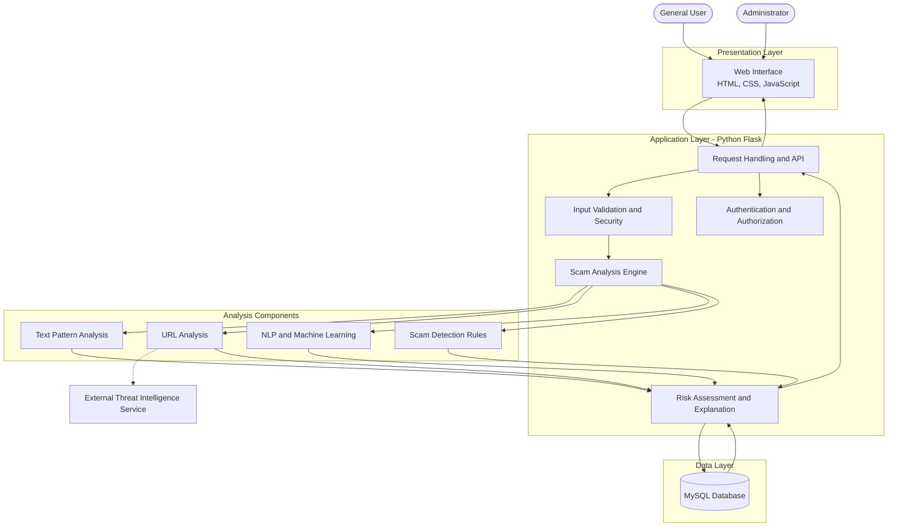

# System Architecture

## 1. Introduction

The system architecture describes the overall structure of ScamSense KE and illustrates how its major components interact to provide digital scam detection and analysis services.

The proposed system will use a modular web-based architecture consisting of a frontend interface, Flask backend, scam analysis engine, MySQL database and optional external threat intelligence services.

## 2. Architecture Diagram

## 3. Description of Architecture Components

### 3.1 Presentation Layer

The presentation layer provides the interface through which users interact with ScamSense KE.

It will be developed using HTML, CSS and JavaScript. Users will be able to submit suspicious messages, URLs and advertisements, view analysis results and receive safety recommendations.

### 3.2 Application Layer

The application layer will be developed using Python Flask.

It will receive user requests, validate submitted information, coordinate the analysis process and communicate with the database.

It will also manage authentication and authorization to ensure that users and administrators access appropriate system functions.

### 3.3 Scam Analysis Engine

The analysis engine is the core component of ScamSense KE.

It will examine submitted content using several techniques:

- Rule-based detection to identify common scam indicators.
- Text pattern analysis to identify suspicious language.
- URL analysis to examine potentially dangerous links.
- Natural Language Processing (NLP) to analyse message context.
- Machine learning to support more advanced scam classification.

The engine will generate risk assessments and explanations based on the indicators identified.

### 3.4 Data Layer

The data layer will use MySQL to store relevant system information, including:

- User account information.
- Submitted suspicious messages and URLs.
- Analysis results.
- Identified scam patterns.
- User reports.
- System records.

Appropriate security controls will be implemented to protect stored information.

### 3.5 External Threat Intelligence Service

The system may integrate with an external threat intelligence service to obtain additional information about suspicious domains and known malicious URLs.

This component will supplement the platform's internal analysis rather than replace it.

## 4. Architecture Design Approach

The proposed architecture follows a modular, layered design. Separating the presentation, application, analysis and data components will make the system easier to develop, test, maintain and extend.

The architecture will also allow additional detection techniques to be introduced without requiring major changes to the entire system.

## 5. Summary

The proposed architecture provides a structured foundation for developing ScamSense KE. It establishes how users interact with the platform, how submitted content is analysed, how results are generated and how system information is stored.